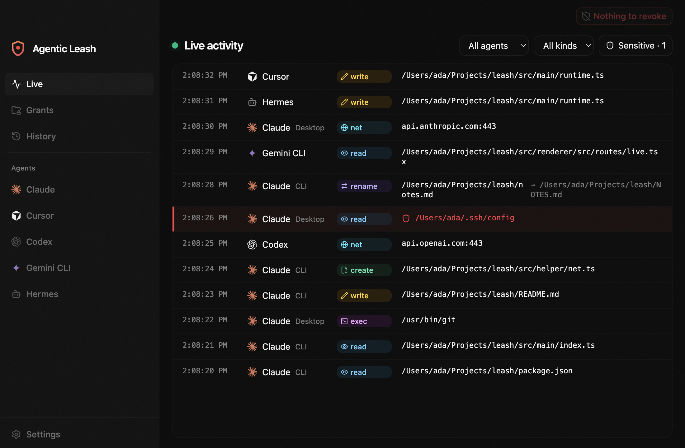

# Agentic Leash

See and control what AI coding agents can touch on your Mac.

[Download Agentic Leash 0.1.2 for Apple Silicon](https://github.com/velusgautam/Agentic-Leash/releases/download/v0.1.2/Agentic.Leash-0.1.2-arm64.dmg)



Claude, Cursor, Codex, Gemini CLI and Hermes keep working. Agentic Leash watches the files they read and write, asks before they reach a folder you have not allowed, and flags sensitive paths like `~/.ssh` the moment they are touched.

- **Setup** installs each agent's hooks, the file-history helper, and Full Disk Access
- **Live** activity from the agents that are installed and turned on, with a red mark on sensitive files
- **Grants** that expire, plus one shortcut to revoke everything and lock down
- **Per-agent** hook install, folders, MCP servers, network rules and macOS privacy
- **Appearance** controls for theme, contrast, transparency and density
- A menu-bar app: closing the window hides it, Quit is in the tray

## Run it

macOS on Apple Silicon, Node 24 and pnpm 12.

```bash
pnpm install
pnpm dev
```

`pnpm test` runs the unit tests. `pnpm test:e2e` launches the window. `pnpm dist` builds `dist/Agentic Leash-0.1.2-arm64.dmg`.

The first open stays on setup until the history helper is running and Full Disk Access is granted. In a dev build the helper step reads "Available in the installed app". Claude covers both the desktop app and the `claude` CLI. Turning an agent off in Settings hides it and removes its hooks. The helper is a root LaunchDaemon, so macOS asks for an administrator password once.
