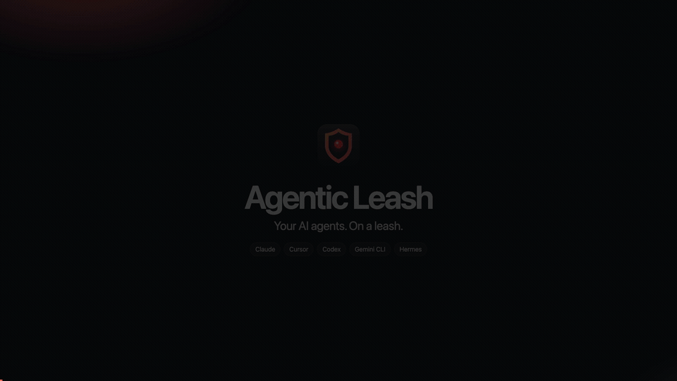
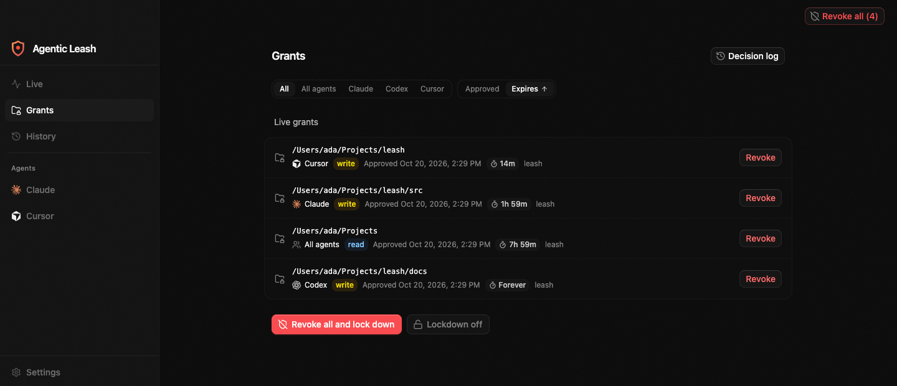
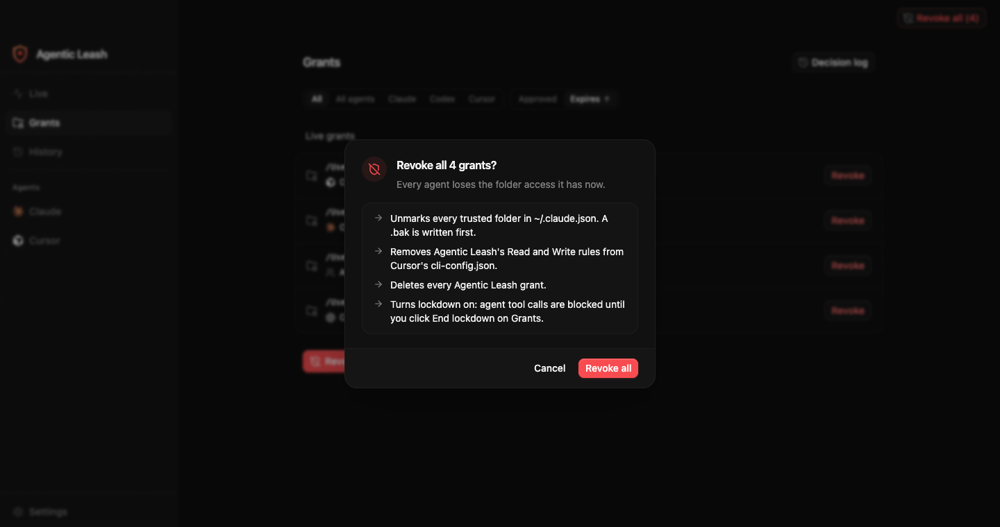
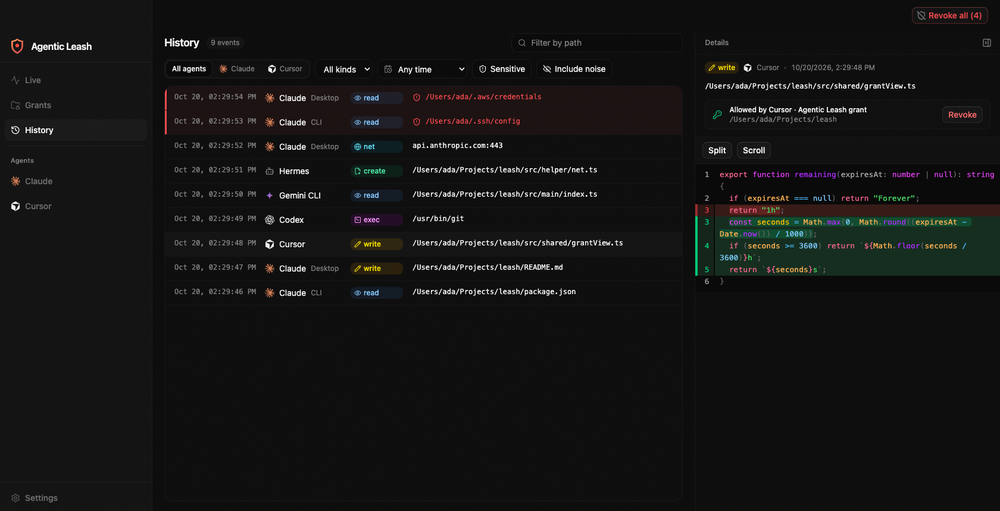
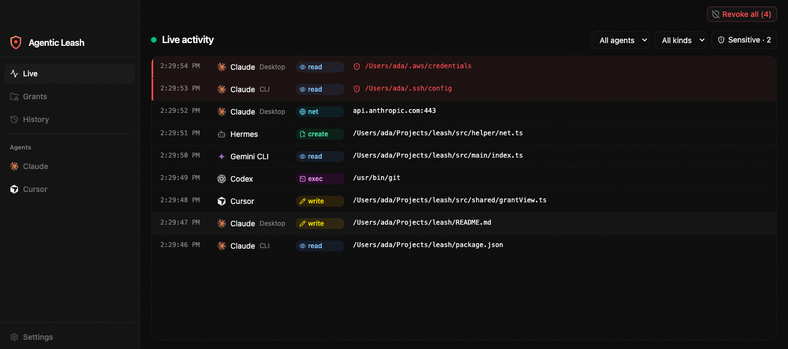
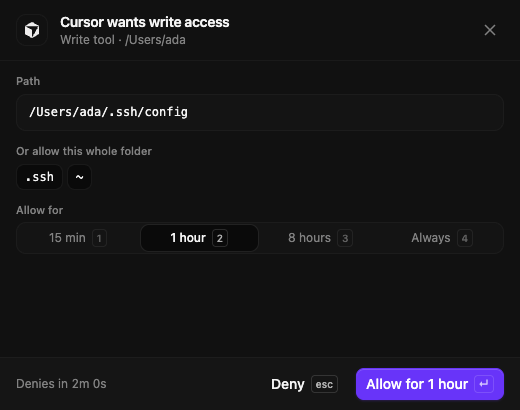
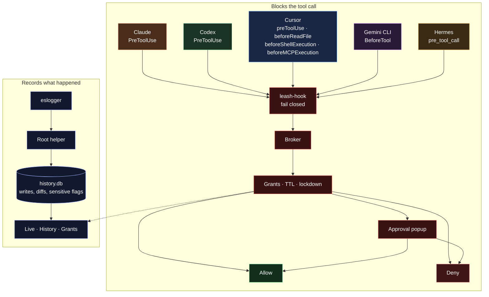

# Agentic Leash

See and control what AI coding agents can touch on your Mac.

[Download Agentic Leash 0.1.2 for Apple Silicon](https://github.com/velusgautam/Agentic-Leash/releases/download/v0.1.2/Agentic.Leash-0.1.2-arm64.dmg)



[Launch video, 1920×1080 MP4](docs/media/launch.mp4)

Claude, Cursor, Codex, Gemini CLI and Hermes keep working. Agentic Leash watches the files they read and write, asks before they reach a folder you have not allowed, and flags sensitive paths like `~/.ssh` the moment they are touched.

## Features

### Grants on a timer



A grant can last 15 minutes, a couple of hours, or forever. Filter the list by agent and sort it by when it was approved or when it expires.

### Revoke, then lock down



Revoke a single grant, or revoke every grant at once. Revoke all turns lockdown on, so the next tool call is blocked until you end it.

### Every write keeps its diff



History stores the before and after of each write. Open it later and the diff is still there, next to the grant that allowed the path.

### Sensitive paths turn red



Reads of `~/.ssh`, `~/.aws` and other secret paths are marked in red on Live and in History, with a count on the Sensitive filter.

### Ask before a new folder



A tool call outside an existing grant opens this popup. Allow it for 15 minutes, 1 hour, 8 hours or always, or deny it. The same choices are on the Grants page while a request is waiting.

## How it hooks in



Setup installs the hook into each agent that is turned on. The hook asks the broker before the tool runs. A matching grant that has not expired is allowed. Lockdown denies. Anything else waits on the approval popup.

Separately, a root helper tails `eslogger` and writes file activity into `history.db`, including the before and after of writes and a sensitive flag. Live and History read that database. The grant shown beside a write is the one whose folder covers the path.

## Run it

macOS on Apple Silicon, Node 24 and pnpm 12.

```bash
pnpm install
pnpm dev
```

`pnpm test` runs the unit tests. `pnpm test:e2e` launches the window. `pnpm dist` builds `dist/Agentic Leash-0.1.2-arm64.dmg`.

The first open stays on setup until the history helper is running and Full Disk Access is granted. In a dev build the helper step reads "Available in the installed app". Claude covers both the desktop app and the `claude` CLI. Turning an agent off in Settings hides it and removes its hooks. The helper is a root LaunchDaemon, so macOS asks for an administrator password once.

`SCREENSHOTS=1 pnpm exec playwright test tests/e2e/marketing.e2e.ts` refreshes the feature images. `node docs/media/launch/record.mjs` rebuilds the MP4 and GIF from those images.
