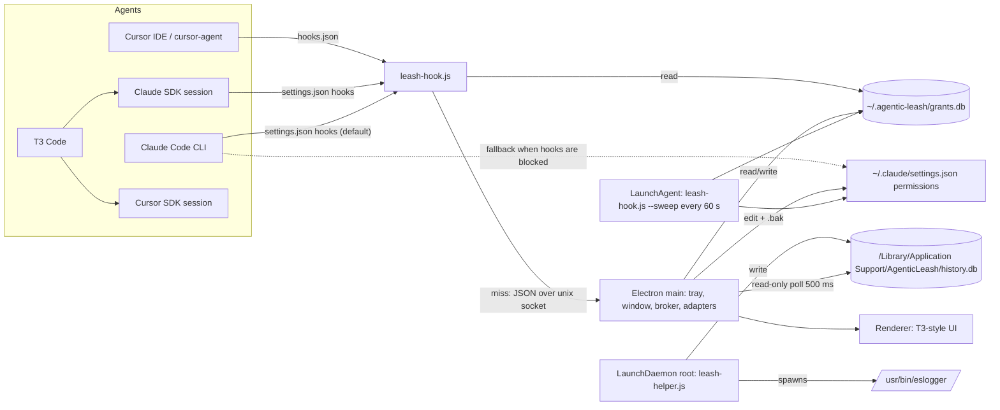

# Agentic Leash Build Plan

> **For agentic workers:** REQUIRED SUB-SKILL: Use superpowers:subagent-driven-development (recommended) or superpowers:executing-plans to implement this plan task-by-task. Steps use checkbox (`- [ ]`) syntax for tracking.

**Goal:** A macOS app that shows and controls which folders, MCP servers, network destinations and macOS permissions every AI coding agent on the machine has, grants time-limited access on request, revokes it instantly, and keeps a tamper-resistant history of every file the agents touched.

**Architecture:** An Electron app (window + menu bar) owns the UI and an approval broker. A hook script, run by the app's own binary in Node mode, is installed into each agent and checks `grants.db` on every tool call. A root LaunchDaemon runs Apple's `eslogger`, follows each agent's process tree, and writes a root-owned `history.db` the app reads.

**Tech Stack:** Electron 44, electron-vite, electron-builder, React 19, TypeScript, Tailwind 4, Base UI / shadcn `base-mira` components copied from T3 Code, lucide icons, TanStack Router, zustand, built-in `node:sqlite`, Vitest.

**Contents:** Sections 1–7 are the build plan. [Appendix A](#appendix-a-research-findings) has every research finding. [Appendix B](#appendix-b-full-decision-log-q1q39) is the full question-by-question decision log.

## Global Constraints

- Platform: macOS 26, Apple Silicon only. Personal tool; no App Store, no notarization in v1.
- One `package.json`, no monorepo, no Effect.
- SQLite only through built-in `node:sqlite` (`DatabaseSync`). No `better-sqlite3`.
- Hook and helper run as `ELECTRON_RUN_AS_NODE=1 "<app>/Contents/MacOS/Agentic Leash" <script>`. Keep the `runAsNode` Electron fuse enabled.
- User data: `~/.agentic-leash/` (`grants.db`, `agentic-leash.sock`). History: `/Library/Application Support/AgenticLeash/history.db`, owned by root, mode `0644`.
- Agentic Leash only restricts. The hook never answers "allow" in a way that skips an agent's own approval prompt (see Q39).
- Never modify company-managed settings: `~/.claude/remote-settings.json`, `~/.cursor/managed/**`, Cursor team admin cache. Show them with a lock.
- Every edit to an agent config file writes `<file>.bak` first.
- Never restart or kill an agent without an explicit click.
- Approval popup timeout: 120 s. Hook `timeout`: 150 s.
- The hook never stores or logs payload `content`, `old_string`, `new_string`, `user_email` or `transcript_path`.
- Time-limit presets: 15 min, 1 h (default), 8 h, Forever.
- Retention: hook decision log 30 days, file history 90 days.
- T3 Code is MIT. Keep its license text in `THIRD_PARTY_LICENSES.md` and on the Settings > Licenses page.
- Commit format (repo is outside `~/Work`, no Jira): `type: Message`, subject line only.

---

## 1. Settled decisions

| Area | Decision |
|---|---|
| Audience | Personal tool first, structured so it can become a product (Q1) |
| Enforcement | Config editor + hook broker; no Endpoint Security / Network Extension entitlements (Q2) |
| "Other apps" | MCP servers (manageable) + macOS Privacy (TCC) grants (view + `tccutil reset`) (Q3) |
| v1 agents | Claude Code, Cursor (IDE + CLI); T3 Code shown as parent of the agents it runs; Codex, Gemini detected only (Q4) |
| Network | Agent-level only: web-fetch rules, sandbox domain lists, URL log, best-effort connection polling (Q5, Q29) |
| Company policy | Shown locked, never changed (Q6) |
| Stack | Electron + React + TS, T3 Code's UI code copied in (Q7, Q35) |
| Running model | Full app with window + Dock icon; close or ⌘Q hides to menu bar; only menu bar Quit exits (Q8, Q16) |
| Missing grant | Popup if app running; otherwise agent fallback (Q9, Q20) |
| Grant shape | Folder, recursive, read or read-write, one agent or all agents, expiry (Q10, Q11) |
| Config-derived access | Shown as "from config"; revoking edits the file after a `.bak` (Q12) |
| Shell commands | Best-effort path detection, labelled in the UI (Q13) |
| Logs | Hook decisions 30 days (Q14); file history 90 days, root-owned (Q30, Q31) |
| Name / repo | Agentic Leash, `~/Projects/agentic-leash` (Q15, Q23) |
| Hook → app | Hook reads `grants.db` directly; only misses go to the app over a Unix socket (Q17) |
| Popup | Drop-down panel from the menu bar; `Enter` = 1 h, `1`–`4` presets, `Esc` = deny; queued (Q18) |
| Layout | T3-style sidebar: Live, Grants, History, Agents list, Settings; right panel for diffs; ⌘K palette (Q36) |
| Settings | General, Agents, Monitoring, Appearance, Keybindings, Diagnostics, Licenses (Q37) |
| Hook install | Merge into existing hook configs, `.bak`, uninstall removes only ours, self-check on launch (Q22) |
| Restarts | "Restart needed" banner, one click, never automatic (Q24) |
| Revoke all | Red button + menu bar item + `⌃⌥⌘L`: clear grants + lockdown (deny everything) + optional stop agents (Q25) |
| Cursor hooks | `failClosed: true` (Q26) |
| Monitoring | Root helper running `eslogger`, process-tree tracking (Q28) |
| After quit | Helper keeps recording; hooks keep enforcing; only popups stop (Q34) |
| Containers | Not in v1. Own implementation in v2, designed in a separate session (Q27, Q33) |

### Facts found while writing this plan (they change two decisions)

1. **The company can block Claude Code user hooks remotely, and it changes.** The company Claude account downloads settings into `~/.claude/remote-settings.json`, rewritten at login and on a schedule. While writing this plan it had `"allowManagedHooksOnly": true`; after a fresh `/login` in Task 0.3 it had `false` and user hooks fired. There is no `/Library/Application Support/ClaudeCode/managed-settings.json` and no Claude Code MDM profile, so a personal Claude account always gets hooks on this Mac. User permission rules are still allowed (`allowManagedPermissionRulesOnly` is absent). Fix: hooks first, with permission rules as an automatic fallback that follows the file live (**Q38**).
2. **Cursor's SDK rejects "ask" from hooks.** T3 Code runs Cursor through `@cursor/sdk` with `settingSources: ["project","user","team",...]`, and its source notes that hooks can only deny or ask, and local SDK runs reject "ask". Cursor's `preToolUse` and `beforeReadFile` also accept only allow/deny. So the Cursor fallback when Agentic Leash is down is **allow** everywhere (Q20 said "Cursor's prompt" for shell).
3. **T3 Code's Claude sessions load user hooks.** T3 Code doesn't set `settingSources` for Claude sessions, and the Agent SDK then loads user, project and local settings.
4. **A Cursor "My Machines" worker runs on this Mac** (`cursor-agent worker start --worker-dir ~/Work/studio`). User-level hooks don't apply to it. It can be monitored, not blocked.
5. **No code-signing identity exists** (`security find-identity -p codesigning -v` → 0). macOS Privacy grants such as Full Disk Access are tied to the code signature, so packaged builds need a stable one (Task 0.4).
6. **The Cursor IDE also runs Claude Code's hooks.** Cursor IDE 3.24.18 runs `~/.claude/settings.json` `PreToolUse` hooks with a Cursor payload, so each tool call reaches Agentic Leash twice. The `cursor-agent` CLI doesn't. Fix: the Claude hook entry gives no opinion when the payload has `cursor_version`.

### Q38 / Q39 (settled)

- **Q38. Hooks first, with permission rules as a fallback.** Each adapter picks a mode at scan time and re-checks it whenever a policy file changes:
  - `hook` (**default for every agent**): Cursor everywhere; Claude Code on personal accounts and on any Mac where user hooks load. This mode gets popups, live expiry and instant revoke.
  - `rules` (**Claude Code fallback only, when hooks are blocked**): blocked means `allowManagedHooksOnly: true` in any managed source, or an effective `disableAllHooks: true`. Agentic Leash then writes Claude's own permission rules in `~/.claude/settings.json`:
    - Grants become `permissions.additionalDirectories` entries.
    - Revokes and sensitive paths become `permissions.deny` rules such as `Read(//Users/velu.gautam/.ssh/**)`.
    - Lockdown adds `deny: ["Read","Edit","Write","Bash","WebFetch","WebSearch","mcp__*"]`.
    - Claude reloads permissions live.
    - Expiry is done by a user LaunchAgent that runs a sweep every 60 s.
    - There is no Leash popup in this mode. Claude's own prompt shows, and the helper still records everything.
  - **Switching modes migrates automatically.** Going from hook to rules writes rules for every live grant. Going from rules to hook removes every rule Agentic Leash wrote. Claude's hook entries stay installed in both modes, so they start working as soon as hooks are allowed.
  - `monitor-only`: no control surface (Cursor worker, Codex and Gemini in v1).
- **Q39. Agentic Leash only restricts.** A covered path returns "no opinion" (Claude: exit 0 with no output; Cursor: `allow`, which T3's SDK notes cannot loosen approval). The hook never returns Claude's `"allow"`, because that would skip Claude's own prompt for actions like `rm -rf` inside a granted folder.

---

## 2. Architecture



### Hook decision flow

1. Parse stdin and normalise it to a `HookRequest`.
2. If lockdown is on, deny.
3. If any path is under a protected root (`~/.agentic-leash`, `/Library/Application Support/AgenticLeash`, the app bundle), deny.
4. If there are no paths (web fetch, MCP), log and return no opinion.
5. If every path is covered by a live grant (Leash or config-derived), log and return no opinion.
6. Otherwise, ask the app over the socket and wait up to 120 s. Allow means no opinion; deny means deny.
7. If the socket is missing or the 120 s timeout passes, fall back: Claude gets `ask`, Cursor gets `allow`.

---

## 3. Repository layout

```
agentic-leash/
  package.json
  electron.vite.config.ts
  electron-builder.yml
  tsconfig.json
  vitest.config.ts
  THIRD_PARTY_LICENSES.md
  resources/
    trayTemplate.png, trayTemplate@2x.png
    com.agenticleash.helper.plist        root LaunchDaemon
    com.agenticleash.sweep.plist         user LaunchAgent (rules-mode expiry, log pruning)
  src/
    shared/
      types.ts                           AgentId, Access, Grant, HookRequest, Verdict, AgentSnapshot, HistoryEvent
      paths.ts                           normalise, isUnder, expandHome, extractShellPaths
      db.ts                              openGrantsDb(), migrations
      constants.ts                       APP_NAME, data dirs, socket path, presets, sensitive globs
    hook/
      leash-hook.ts                      entry: stdin → normalise → decide → respond; --sweep mode
      normalise.ts                       per-agent payload → HookRequest
      decide.ts                          pure decision function
      respond.ts                         Verdict → per-agent stdout/exit code
      sweep.ts                           expire grants, rewrite rules-mode configs, prune logs
    helper/
      leash-helper.ts                    root entry: spawn eslogger, batch-write history
      proctree.ts                        fork/exec/exit tracking of agent process trees
      classify.ts                        eslogger event → HistoryEvent | null
      snapshots.ts                       content cache + before/after blobs
      net.ts                             lsof polling of tracked pids
      historyDb.ts                       schema, batch insert, 90-day prune
    main/
      index.ts                           lifecycle: window, close→hide, ⌘Q→hide, login item
      menus.ts                           app and tray menu templates
      uiState.ts                         ui-state.json in userData
      loginItem.ts                       login LaunchAgent
      tray.ts                            menu bar icon, badge, menu
      broker.ts                          unix socket server, approval queue
      approvalWindow.ts                  drop-down panel window
      grants.ts                          CRUD, lockdown, revokeAll
      ipc.ts                             typed IPC handlers for the renderer
      agents/
        adapter.ts                       AgentAdapter interface, registry
        claude.ts, cursor.ts, t3.ts, codex.ts, gemini.ts
        tcc.ts                           read TCC.db, tccutil reset
      hookInstall.ts                     merge / uninstall / verify hooks
      rulesMode.ts                       write Claude permission rules with .bak
      restart.ts                         detect running agents, restart actions
      helperInstall.ts                   install LaunchDaemon + LaunchAgent via admin prompt
      history.ts                         read-only poller over history.db
    preload/index.ts
    renderer/
      index.html
      src/main.tsx, router.tsx, nav.ts, env.ts, index.css   index.css copied from T3 Code
      src/components/ui/*                copied from T3 Code apps/web/src/components/ui, as needed
      src/components/AppLayout.tsx       built from T3's ui/sidebar parts
      src/components/settings.tsx        PageContainer, SettingsSection, SettingsRow (T3 markup)
      src/components/CommandPalette.tsx  adapted from T3 Code (M5)
      src/components/DiffPanel.tsx       adapted from T3 Code (@pierre/diffs) (M4)
      src/routes/live.tsx, grants.tsx, history.tsx, agent.tsx, settings.tsx, approval.tsx (M3)
  tests/
    fixtures/hooks/*.json                captured in Task 0.3
    fixtures/eslogger/*.jsonl            captured in Task 0.2
    *.test.ts
```

---

## 4. Data contracts

### `src/shared/types.ts`

```ts
export type AgentId = "claude-code" | "cursor" | "t3-code" | "codex" | "gemini";
export type Access = "read" | "write";
export type Enforcement = "hook" | "rules" | "monitor-only";

export interface Grant {
  id: number;
  agent: AgentId | "*";
  path: string;
  access: Access;
  source: "leash" | "config";
  createdAt: number;
  expiresAt: number | null;
}

export interface HookRequest {
  agent: "claude-code" | "cursor";
  event: string;
  tool: string;
  access: Access;
  paths: string[];
  cwd: string;
  url?: string;
  command?: string;
  sessionId?: string;
}

export type Verdict =
  | { kind: "pass" }
  | { kind: "deny"; reason: string }
  | { kind: "prompt" };

export interface DecideOptions {
  now: number;
  lockdown: boolean;
  protectedRoots: string[];
}

export interface HistoryEvent {
  ts: number;
  agent: AgentId | "unknown";
  pid: number;
  exe: string;
  kind: "read" | "write" | "create" | "delete" | "rename" | "exec" | "net";
  path: string;
  destPath?: string;
  sha256?: string;
  beforeBlob?: string;
  afterBlob?: string;
  sensitive: boolean;
  source: "eslogger" | "hook" | "net";
}
```

### `grants.db` (user-owned, `~/.agentic-leash/grants.db`, WAL)

```sql
CREATE TABLE IF NOT EXISTS grants (
  id INTEGER PRIMARY KEY,
  agent TEXT NOT NULL,
  path TEXT NOT NULL,
  access TEXT NOT NULL CHECK (access IN ('read','write')),
  source TEXT NOT NULL CHECK (source IN ('leash','config')),
  created_at INTEGER NOT NULL,
  expires_at INTEGER
);
CREATE INDEX IF NOT EXISTS grants_live ON grants (agent, expires_at);
CREATE TABLE IF NOT EXISTS settings (key TEXT PRIMARY KEY, value TEXT NOT NULL);
CREATE TABLE IF NOT EXISTS decisions (
  id INTEGER PRIMARY KEY,
  ts INTEGER NOT NULL,
  agent TEXT NOT NULL,
  tool TEXT NOT NULL,
  paths TEXT NOT NULL,
  verdict TEXT NOT NULL,
  reason TEXT,
  grant_id INTEGER
);
```

Settings keys: `lockdown` (`"0"`/`"1"`), `popup_timeout_s` (`"120"`), `default_ttl_s` (`"3600"`).

### `history.db` (root-owned, `journal_mode=DELETE` so the app can open it read-only)

```sql
CREATE TABLE IF NOT EXISTS events (
  id INTEGER PRIMARY KEY,
  ts INTEGER NOT NULL,
  agent TEXT NOT NULL,
  pid INTEGER NOT NULL,
  exe TEXT NOT NULL,
  kind TEXT NOT NULL,
  path TEXT NOT NULL,
  dest_path TEXT,
  sha256 TEXT,
  before_blob TEXT,
  after_blob TEXT,
  sensitive INTEGER NOT NULL DEFAULT 0,
  source TEXT NOT NULL,
  minute_key TEXT
);
CREATE UNIQUE INDEX IF NOT EXISTS events_read_collapse ON events (minute_key) WHERE minute_key IS NOT NULL;
CREATE INDEX IF NOT EXISTS events_path ON events (path, ts);
CREATE TABLE IF NOT EXISTS blobs (sha256 TEXT PRIMARY KEY, content BLOB NOT NULL);
```

Reads set `minute_key = agent || '|' || path || '|' || floor(ts/60000)` and insert with `INSERT OR IGNORE`, giving one row per agent, path and minute.

### Per-agent hook payloads → `HookRequest`

| Agent / event | Input fields used | Output for `deny` | Output for `pass` | Fallback |
|---|---|---|---|---|
| Claude `PreToolUse` | `tool_name`, `tool_input.file_path` (Read/Edit/Write/MultiEdit), `tool_input.notebook_path`, `tool_input.path` (Glob/Grep), `tool_input.command` (Bash), `tool_input.url` (WebFetch), `cwd`, `session_id` | stdout `{"hookSpecificOutput":{"hookEventName":"PreToolUse","permissionDecision":"deny","permissionDecisionReason":"…"}}`, exit 0 | no stdout, exit 0 | `permissionDecision: "ask"` |
| Cursor `preToolUse` | `tool_name`, `tool_input` (Shell: `command`, `cwd`; Read/Write: `file_path`), `cwd`, `workspace_roots` | `{"permission":"deny","user_message":"…","agent_message":"…"}` | `{"permission":"allow"}` | `allow` |
| Cursor `beforeReadFile` | `file_path` | same as above | `{"permission":"allow"}` | `allow` |
| Cursor `beforeShellExecution` | `command`, `cwd` | same as above | `{"permission":"allow"}` | `allow` |
| Cursor `beforeMCPExecution` | `mcp_server_name`, `tool_name` | same as above (lockdown only) | `{"permission":"allow"}` | `allow` |

Claude matcher: `Read|Edit|Write|MultiEdit|NotebookEdit|Glob|Grep|Bash|WebFetch|WebSearch|mcp__.*`.

A payload with `cursor_version` that arrives through the Claude entry comes from the Cursor IDE: exit 0 with no stdout, and let the Cursor entry decide.

---

## 5. Milestones and time estimates

| Milestone | What works at the end | Estimate |
|---|---|---|
| M0 Spikes | Hook latency, `eslogger` load, real hook payloads and signing are measured, not guessed | 1 day |
| M1 App shell | T3-style window, sidebar, settings skeleton; close/⌘Q hide to menu bar; tray Quit exits; starts at login | 3 days |
| M2 Agents view | Every agent's folders, MCP servers, network rules and company locks visible; T3 Code nests its agents | 3 days |
| M3 Grants + enforcement | Grants with expiry, popup approvals, hook install, Claude rules mode, Revoke all + lockdown, restart banner, decision log | 6 days |
| M4 Monitoring + history | Root helper, Live feed, History with diffs, sensitive-path alerts, network log, TCC view | 6 days |
| M5 Polish + package | ⌘K, keybindings, appearance, diagnostics, onboarding, signed `.dmg` | 2 days |
| **Total** | | **≈ 21 working days (≈ 4 weeks full-time, ≈ 3 months of evenings)** |

Detailed step-by-step TDD plans for M1–M5 are written right before each milestone starts, because M0's measurements decide details inside them (hook runtime, `eslogger` field names, Cursor file-tool fields). Each milestone below lists its tasks, files and acceptance checks.

---

## Milestone 0: Spikes (1 day)

### Task 0.1: Hook start-up latency

**Files:**
- Create: `spikes/package.json`, `spikes/hook-latency.mjs`, `spikes/measure.mjs`

- [ ] **Step 1: Install Electron 44 in the spike folder**

```bash
cd ~/Projects/agentic-leash/spikes && pnpm init && pnpm add -D electron@44
```

- [ ] **Step 2: Write the fake hook**

```js
// spikes/hook-latency.mjs
import { DatabaseSync } from "node:sqlite";
import { mkdirSync } from "node:fs";
const dir = `${process.env.HOME}/.agentic-leash`;
mkdirSync(dir, { recursive: true });
const db = new DatabaseSync(`${dir}/spike.db`);
db.exec("CREATE TABLE IF NOT EXISTS grants (path TEXT, expires_at INTEGER)");
const row = db.prepare("SELECT count(*) AS n FROM grants WHERE expires_at > ?").get(Date.now());
process.stdout.write(JSON.stringify(row));
```

- [ ] **Step 3: Write the timer**

```js
// spikes/measure.mjs
import { spawnSync } from "node:child_process";
const [cmd, ...args] = process.argv.slice(2);
const times = [];
for (let i = 0; i < 30; i++) {
  const start = process.hrtime.bigint();
  spawnSync(cmd, args, { env: { ...process.env, ELECTRON_RUN_AS_NODE: "1" }, input: "{}" });
  times.push(Number(process.hrtime.bigint() - start) / 1e6);
}
times.sort((a, b) => a - b);
console.log(`p50 ${times[15].toFixed(0)} ms  p95 ${times[28].toFixed(0)} ms`);
```

- [ ] **Step 4: Measure Electron-as-Node vs system Node**

```bash
node measure.mjs node_modules/electron/dist/Electron.app/Contents/MacOS/Electron hook-latency.mjs
node measure.mjs node hook-latency.mjs
```

Expected: two lines like `p50 … ms  p95 … ms`. **Pass:** Electron p95 < 150 ms → keep the Electron-as-Node runtime. **Fail:** use system Node if its p95 < 150 ms and record the Node path in settings. Otherwise, add Bun and compile the hook with `bun build --compile` in M3.

- [ ] **Step 5: Write the numbers into `docs/plans/spike-results.md`**

### Task 0.2: `eslogger` event volume

**Files:**
- Create: `spikes/es-parse.mjs`, `tests/fixtures/eslogger/*.jsonl`

- [ ] **Step 1: Give Terminal Full Disk Access** (System Settings > Privacy & Security > Full Disk Access > Terminal). `eslogger` refuses to start without it.
- [ ] **Step 2: Record 60 s while an agent works in T3 Code**

```bash
spikes/record-eslogger.sh
```

Expected: line count and file size. Events per second = lines / 60.

- [ ] **Step 3: Measure parse throughput**

```js
// spikes/es-parse.mjs
import { createReadStream } from "node:fs";
import { createInterface } from "node:readline";
const start = process.hrtime.bigint();
let n = 0;
for await (const line of createInterface({ input: createReadStream(process.argv[2]) })) {
  JSON.parse(line);
  n++;
}
const s = Number(process.hrtime.bigint() - start) / 1e9;
console.log(`${n} events in ${s.toFixed(2)} s = ${(n / s).toFixed(0)} events/s`);
```

```bash
node es-parse.mjs /tmp/es-60s.jsonl
```

**Pass:** parse rate ≥ 10× the recorded events/second. **Fail:** switch the helper's source to `fs_usage -w -f filesys <pid…>` filtered to agent pids, and record that in `spike-results.md`.

- [ ] **Step 4: Save 20 sample lines per event type** into `tests/fixtures/eslogger/<type>.jsonl` and note the JSON paths for pid, ppid, executable path, file path, rename destination and open flags in `spike-results.md`.

### Task 0.3: Real hook payloads

**Files:**
- Create: `spikes/capture-hook.sh`, `tests/fixtures/hooks/*.json`

- [ ] **Step 1: Write the capture hook**

```sh
#!/bin/sh
mkdir -p /tmp/agentic-leash-capture
cat > "/tmp/agentic-leash-capture/$1-$2-$(date +%s)-$$.json"
[ "$1" = "cursor" ] && printf '{"permission":"allow"}'
exit 0
```

```bash
chmod +x ~/Projects/agentic-leash/spikes/capture-hook.sh
```

- [ ] **Step 2: Back up and register it in Cursor**

```bash
cp ~/.cursor/hooks.json ~/.cursor/hooks.json.bak 2>/dev/null || true
```

Add to `~/.cursor/hooks.json` (merge with existing entries):

```json
{
  "version": 1,
  "hooks": {
    "preToolUse": [{ "command": "/Users/velu.gautam/Projects/agentic-leash/spikes/capture-hook.sh cursor preToolUse" }],
    "beforeReadFile": [{ "command": "/Users/velu.gautam/Projects/agentic-leash/spikes/capture-hook.sh cursor beforeReadFile" }],
    "beforeShellExecution": [{ "command": "/Users/velu.gautam/Projects/agentic-leash/spikes/capture-hook.sh cursor beforeShellExecution" }],
    "beforeMCPExecution": [{ "command": "/Users/velu.gautam/Projects/agentic-leash/spikes/capture-hook.sh cursor beforeMCPExecution" }]
  }
}
```

- [ ] **Step 3: Trigger each tool** (read, edit, shell, MCP) once in the Cursor IDE, once in `cursor-agent`, and once in a T3 Code Cursor thread.
- [ ] **Step 4: Check Claude in both account types.**
  1. **Company account:** add the same script as a `PreToolUse` hook in `~/.claude/settings.json` (back it up first), run `claude -p "read package.json"`, and confirm no `claude-*` capture files appear. That confirms the rules fallback is needed here.
  2. **Personal account:** run `mkdir -p ~/.claude-personal && CLAUDE_CONFIG_DIR=~/.claude-personal claude` and sign in with a personal account. Add the hook to `~/.claude-personal/settings.json`, then run `CLAUDE_CONFIG_DIR=~/.claude-personal claude -p "read package.json"`. Confirm `claude-*` capture files appear; they become the Claude hook fixtures.
- [ ] **Step 5: Copy one payload per agent and event** into `tests/fixtures/hooks/` and restore both `.bak` files.

### Task 0.4: Stable signing identity

- [ ] **Step 1:** Keychain Access > Certificate Assistant > Create a Certificate… Name `Agentic Leash Dev`, Identity Type `Self-Signed Root`, Certificate Type `Code Signing`.
- [ ] **Step 2:** Verify:

```bash
security find-identity -p codesigning -v
```

Expected: `1 valid identities found` including `"Agentic Leash Dev"`.

- [ ] **Step 3: Commit the spike results**

```bash
git add docs/plans/spike-results.md tests/fixtures spikes
git commit -m "chore: Record milestone 0 spike results"
```

---

## Milestone 1: App shell (3 days)

**Status:** done. Detailed plan and deviations: [2026-10-15-m1-app-shell.md](2026-10-15-m1-app-shell.md).

**Tasks:**
1. **Scaffold.** Run `pnpm create @quick-start/electron /tmp/al-scaffold --template react-ts`, move its files into the repo root, pin `electron@44`, and add Tailwind 4, TanStack Router, zustand, lucide-react and Vitest.
2. **Copy T3 UI.** Sparse-clone T3 Code, copy `apps/web/src/components/ui/*`, `apps/web/src/index.css` and the `lib/utils` helpers, then strip Effect and chat-specific imports until `pnpm typecheck` passes. Add `THIRD_PARTY_LICENSES.md` with T3 Code's MIT text.

   ```bash
   git clone --depth 1 --filter=blob:none --sparse https://github.com/pingdotgg/t3code /tmp/t3code
   git -C /tmp/t3code sparse-checkout set apps/web/src/components apps/web/src/lib apps/web/src/index.css
   ```

3. **Layout.** Adapt `AppSidebarLayout` with the Live, Grants and History links, the Agents list (static for now) and Settings at the bottom, plus empty route pages and the settings pages from Q37.
4. **Window and menu bar lifecycle** in `src/main/index.ts` and `src/main/tray.ts`:

   ```ts
   let quitting = false;
   app.on("before-quit", () => { quitting = true; });

   function hideToMenuBar(win: BrowserWindow) {
     win.hide();
     app.dock?.hide();
   }
   function showWindow(win: BrowserWindow) {
     app.dock?.show();
     win.show();
     win.focus();
   }

   win.on("close", (e) => {
     if (quitting) return;
     e.preventDefault();
     hideToMenuBar(win);
   });

   Menu.setApplicationMenu(Menu.buildFromTemplate([
     { label: app.name, submenu: [
       { role: "about" },
       { type: "separator" },
       { label: "Hide to Menu Bar", accelerator: "Command+Q", click: () => hideToMenuBar(win) },
     ] },
     { role: "editMenu" },
     { role: "windowMenu" },
   ]));

   app.setLoginItemSettings({ openAtLogin: true });
   ```

   The tray menu has Open Agentic Leash, Pending requests (n), Revoke all and **Quit Agentic Leash**, which does `quitting = true; app.quit()`. `before-quit` also fires on logout and shutdown, so those still quit. Start hidden when `app.getLoginItemSettings().wasOpenedAtLogin` is true. Show a one-time notification the first time the window hides.

5. **Delete `spikes/`** once the shell is in place.

**Accept:**
- `pnpm dev` opens the window.
- The red close button and ⌘Q both hide the window and the Dock icon, and the menu bar icon stays.
- Tray Quit exits (`pgrep -f "Agentic Leash"` returns nothing).
- After logout and login, the app is running.

## Milestone 2: Agents view (3 days)

**Interface (`src/main/agents/adapter.ts`):**

```ts
export interface AgentSnapshot {
  id: AgentId;
  name: string;
  installed: boolean;
  enforcement: Enforcement;
  folders: { path: string; access: Access; source: string; locked: boolean }[];
  mcpServers: { name: string; url?: string; command?: string; source: string; locked: boolean }[];
  network: { rule: string; effect: "allow" | "deny"; source: string; locked: boolean }[];
  children: AgentId[];
}
export interface AgentAdapter {
  id: AgentId;
  scan(): Promise<AgentSnapshot>;
  watchPaths(): string[];
}
```

**Tasks:**
1. **`claude.ts`** reads:
   - `~/.claude/settings.json` and `settings.local.json`: `permissions.allow`, `deny`, `ask`, `additionalDirectories`, and `sandbox.*`.
   - `~/.claude.json`: `projects[path].hasTrustDialogAccepted` and `mcpServers`.
   - `~/.claude/remote-settings.json`: shown locked.

   The config folder is `$CLAUDE_CONFIG_DIR` when it's set, otherwise `~/.claude`. Mode detection, tested against fixtures for a personal account, a company account and a hooks-disabled setup:

   ```ts
   const MANAGED_SOURCES = [
     join(claudeDir, "remote-settings.json"),
     "/Library/Application Support/ClaudeCode/managed-settings.json",
   ];

   type ClaudeSettings = { allowManagedHooksOnly?: boolean; disableAllHooks?: boolean };

   export function claudeHooksBlocked(managed: ClaudeSettings[], effective: ClaudeSettings): boolean {
     return managed.some((s) => s.allowManagedHooksOnly === true) || effective.disableAllHooks === true;
   }
   ```

   Also read every `*.json` in `/Library/Application Support/ClaudeCode/managed-settings.d/`. Missing files count as `{}`. Enforcement is `rules` when `claudeHooksBlocked` is true, otherwise `hook`. Re-run on any change to these files.
2. **`cursor.ts`** reads:
   - `~/.cursor/cli-config.json`: `permissions` and `sandbox`.
   - `~/.cursor/sandbox.json` and `<repo>/.cursor/sandbox.json`.
   - `~/.cursor/mcp.json`.
   - The `autorun.cachedAdminSettings` key from `~/Library/Application Support/Cursor/User/globalStorage/state.vscdb`, opened read-only with `node:sqlite` and shown locked.

   Enforcement is `hook`. Running `cursor-agent worker` processes are listed as `monitor-only`.
3. **`t3.ts`** reads `~/.t3/userdata/settings.json` for enabled providers and `binaryPath`, and sets `children` to the enabled agents.
4. **`codex.ts` and `gemini.ts`** only detect `~/.codex/config.toml` and `~/.gemini/settings.json`/`trustedFolders.json`, and report `monitor-only`.
5. **Mirror config-derived folders** into `grants` with `source='config'` on every scan, so the hook only reads one table.
6. **Re-scan** on `fs.watch` of every `watchPaths()` entry, debounced by 300 ms.
7. **Build the `agents.$id.tsx` page** with Folders, MCP servers, Network and macOS Privacy sections (the Privacy section is filled in M4). Locked rows show 🔒 and the source file.

**Accept:**
- Unit tests parse real copies of your configs (secrets redacted) in `tests/fixtures/configs/`.
- On this Mac (company account), the Claude Code page shows "Rules mode (fallback): company policy blocks hooks", and the WBD deny rules are locked.
- With `CLAUDE_CONFIG_DIR=~/.claude-personal`, signed in to a personal account, the page shows hook mode.
- T3 Code shows Claude Code and Cursor nested under it.

## Milestone 3: Grants + enforcement (6 days)

**Tasks:**
1. **`decide.ts`** is a pure function, with unit tests written first:

   ```ts
   export function decide(req: HookRequest, grants: Grant[], opts: DecideOptions): Verdict {
     if (opts.lockdown) return { kind: "deny", reason: "Agentic Leash lockdown is on" };
     if (req.paths.some((p) => opts.protectedRoots.some((r) => isUnder(p, r)))) {
       return { kind: "deny", reason: "Agentic Leash protects its own files" };
     }
     if (req.paths.length === 0) return { kind: "pass" };
     const live = grants.filter(
       (g) => (g.agent === "*" || g.agent === req.agent) && (g.expiresAt === null || g.expiresAt > opts.now),
     );
     const covered = req.paths.every((p) =>
       live.some((g) => isUnder(p, g.path) && (g.access === "write" || req.access === "read")),
     );
     return covered ? { kind: "pass" } : { kind: "prompt" };
   }
   ```

   Tests cover:
   - Lockdown denies.
   - A protected root denies.
   - An expired grant prompts.
   - A read grant on a write request prompts.
   - A `*` grant covers every agent.
   - `/a/bc` is not under `/a/b`.
2. **`paths.ts` → `extractShellPaths(command, cwd)`** returns `cwd` plus every token starting with `/`, `~/`, `./` or `../`, resolved and normalised. Tests cover `cat ~/.ssh/id_rsa`, `cd ../x && ls`, and quoted paths. The best-effort label shows in the UI.
3. **`normalise.ts` and `respond.ts`** implement the table in section 4, with tests against the `tests/fixtures/hooks/*.json` files from Task 0.3.
4. **`broker.ts`** runs a `net.createServer` on `~/.agentic-leash/agentic-leash.sock` (mode `0600`) using newline-delimited JSON (`{id, request}` → `{id, decision: "allow"|"deny", ttlSeconds}`). On allow, the app inserts the grant before replying, so the next call is a cache hit.
5. **`approvalWindow.ts` and `routes/approval.tsx`** build a frameless, always-on-top panel positioned from `tray.getBounds()`, holding a queue of requests. `Enter` allows for 1 h, `1`–`4` pick a preset, `Esc` denies. The panel auto-falls back after 120 s, and the tray title shows the pending count.
6. **`hookInstall.ts`**:
   - Write `.bak` copies.
   - Merge Agentic Leash's entries, identified by the hook command path, into `~/.cursor/hooks.json` (`timeout: 150`, `failClosed: true`) and into the Claude config folder's `settings.json` `hooks.PreToolUse` (`timeout: 150`). Claude's entries are installed in both modes, because they're harmless when blocked and start working the moment hooks are allowed.
   - Uninstall removes only those entries.
   - On launch, check the entries still exist and show a banner if they're missing.
   - Running Cursor sessions don't reload `hooks.json` (Task 0.3), so after an install, show the restart banner from task 10 with "start new agent sessions".
7. **`rulesMode.ts`** is the fallback, active only while `claudeHooksBlocked` is true. It writes the Q38 rules into the Claude config folder's `settings.json` (`additionalDirectories` for grants, `deny` for revokes, sensitive paths and lockdown) after a `.bak`. Every rule Agentic Leash writes is also recorded in `grants.db`, so removal is exact. `syncClaudeMode(prev, next)` migrates on a mode change: hook→rules writes rules for live grants, and rules→hook removes all Leash-written rules.
8. **`sweep.ts` plus the `com.agenticleash.sweep` LaunchAgent** (`StartInterval` 60) expire rules-mode grants and prune `decisions` older than 30 days.
9. **`grants.ts`** handles revokeAll: delete `source='leash'` grants, set `lockdown=1`, apply lockdown rules in rules mode, and then offer to stop running agents. Register `globalShortcut` `Control+Alt+Command+L`. Add the red button in the sidebar footer and the tray item.
10. **`restart.ts`** lists running agents from `ps -axo pid,ppid,args`:
    - GUI apps quit with `osascript -e 'tell application id "<bundle id>" to quit'` and reopen with `open -b <bundle id>`.
    - Command-line agents get `SIGTERM`, with the hint `claude --continue`.

    The banner appears only after config-file edits.
11. **Grants page:** live countdowns and Revoke buttons. A Log sub-view shows `decisions`.
12. **Config edits from the Agents page**, each with a `.bak` and a restart banner when needed:
    - MCP servers: disable or remove. For Claude, move the server name into `disabledMcpjsonServers` or remove it from `~/.claude.json` `mcpServers`. For Cursor, remove it from `~/.cursor/mcp.json`.
    - Network rules: add or remove domains. For Claude, use `sandbox.network.allowedDomains`/`deniedDomains` and `WebFetch(domain:…)` deny rules. For Cursor, use `sandbox.json` `networkPolicy.allow`/`deny`.
    - Locked rows have no edit controls.

**Accept:**
- In a T3 Code Cursor thread, reading `~/Desktop/x.txt` shows the popup. `Esc` blocks the read, and the agent reports it was denied.
- Allowing for 15 min lets it through; after 15 min it prompts again.
- `⌃⌥⌘L` makes the next Cursor tool call fail with the lockdown message, even after tray Quit.
- **Claude, rules fallback (this Mac, company account):** granting `~/Desktop` adds it to `additionalDirectories`, and the sweep removes it at expiry.
- **Claude, hook mode** (`CLAUDE_CONFIG_DIR=~/.claude-personal claude`, personal account): reading `~/Desktop/x.txt` shows the Leash popup, and `Esc` blocks it.
- **Mode switch:** adding `"allowManagedHooksOnly": true` to a personal-profile fixture of `remote-settings.json` flips the profile to rules mode and writes rules for live grants. Removing it deletes them.
- Hook p95 latency is under 150 ms (Diagnostics page).

## Milestone 4: Monitoring + history (6 days)

**Tasks:**
1. **`helperInstall.ts`** copies `com.agenticleash.helper.plist` to `/Library/LaunchDaemons/` and runs `launchctl bootstrap system …`, through a single `osascript -e 'do shell script "…" with administrator privileges'`. The onboarding step then asks you to grant Full Disk Access to Agentic Leash.app.

   ```xml
   <?xml version="1.0" encoding="UTF-8"?>
   <!DOCTYPE plist PUBLIC "-//Apple//DTD PLIST 1.0//EN" "http://www.apple.com/DTDs/PropertyList-1.0.dtd">
   <plist version="1.0"><dict>
     <key>Label</key><string>com.agenticleash.helper</string>
     <key>ProgramArguments</key><array>
       <string>/Applications/Agentic Leash.app/Contents/MacOS/Agentic Leash</string>
       <string>/Applications/Agentic Leash.app/Contents/Resources/app.asar.unpacked/out/helper/leash-helper.js</string>
     </array>
     <key>EnvironmentVariables</key><dict><key>ELECTRON_RUN_AS_NODE</key><string>1</string></dict>
     <key>RunAtLoad</key><true/>
     <key>KeepAlive</key><true/>
   </dict></plist>
   ```

2. **`proctree.ts`**:
   - Roots are `exec` events whose executable basename is `claude`, `cursor-agent`, `codex`, `gemini` or `opencode`, plus processes whose parent is T3 Code's server process.
   - On `fork`, a child of a tracked pid joins the tree. On `exit`, it leaves.
   - Tests replay `tests/fixtures/eslogger/*.jsonl`.
3. **`classify.ts`** turns eslogger events into `HistoryEvent` for tracked pids only:
   - Never subscribe to `write`: eslogger logs its own output writes (Task 0.2).
   - `open` without `FWRITE` (`fflag & 2`) → `read`.
   - `close` with modified → `write`.
   - `create`, `unlink` and `rename` map one-to-one.
   - `exec` → `exec`.
   - Paths on the skip list (`node_modules`, `.git/objects`, `~/Library/Caches`, editable in Settings > Monitoring) are dropped for reads only.
   - Sensitive globs (`~/.ssh/**`, `~/.aws/**`, `**/.env*`, `~/Library/Keychains/**`) set `sensitive`.
4. **`snapshots.ts`**: `eslogger` reports events after they happen, so a "before" copy can't be read at write time. Keep a content cache instead: on the first read of a text file of 1 MB or less inside a granted folder, store a blob. On a write, `before` is the cached blob, or `git show HEAD:<path>` when the file is in a git repo. `after` is read right away. Label diffs "best-effort baseline" in the UI.
5. **`historyDb.ts`**: batch inserts every 250 ms in one transaction, a daily prune of events older than 90 days, and removal of orphaned blobs. Directory `0755 root:wheel`, file `0644`.
6. **`net.ts`**: every 2 s, run `lsof -nP -i -a -p <tracked pids>` and record new `(pid, remote)` pairs as `net` events. Hook-logged web-fetch URLs are recorded in `decisions`.
7. **`history.ts` (app)**: open `history.db` with `new DatabaseSync(path, { readOnly: true })` and poll `WHERE id > ?` every 500 ms. Send new rows to the Live view, and show a macOS notification for `sensitive` rows. Rows flagged while the app was quit notify at next launch.
8. **Live view:** a streaming list (agent dot, kind icon, path, time) with filters for agent, kind and sensitive. **History view:** search by path or agent, plus a date range. Clicking a write row opens the T3-style `DiffPanel` with the before and after blobs.
9. **`tcc.ts`**: read `~/Library/Application Support/com.apple.TCC/TCC.db` (`access` table: `service`, `client`, `auth_value`) for the agent host bundle IDs (`com.todesktop.230313mzl4w4u92` for Cursor, `com.t3tools.t3code`, `com.anthropic.claudefordesktop`, `com.apple.Terminal`). Show this on each agent page, with a **Reset** button running `tccutil reset <Service> <bundle id>`.

**Accept:**
- With Claude running in T3 Code, `cat ~/.ssh/config` run by the agent appears in Live within 2 s, flagged red, with a notification.
- Editing a file through the agent shows a diff in History.
- Trying to delete `history.db` as your user fails with `Permission denied`.
- The helper keeps logging after tray Quit.

## Milestone 5: Polish + package (2 days)

**Tasks:**
1. **⌘K palette** with grant folder, revoke grant, jump to agent and Revoke all, adapted from T3 Code's `CommandPalette`.
2. **Settings > Keybindings**, adapted from T3 Code's keybindings page.
3. **Settings > Appearance:** light, dark or system, from T3 Code's theme tokens.
4. **Settings > Diagnostics:** hook p50/p95 from `decisions` timings, helper status (`launchctl print system/com.agenticleash.helper`), last sweep run, and hook install health.
5. **First-run onboarding wizard** (T3 `wizard.tsx`):
   1. Install hooks.
   2. Install the helper.
   3. Grant Full Disk Access.
   4. Allow start at login.
6. **`electron-builder.yml`**:
   - `mac.target: dmg`, `arch: arm64`.
   - `asarUnpack: ["out/hook/**", "out/helper/**"]`.
   - `mac.identity: "Agentic Leash Dev"`.
   - `hardenedRuntime: false` for v1.

**Accept:**
- `pnpm dist` produces `dist/Agentic Leash-<version>-arm64.dmg`.
- After installing over a previous build, Full Disk Access is still granted.

## Design follow-up (after packaging)

**Status:** first pass done (2026-10-16).

- App icon: graphite tile, coral leash-shaped shield, amber signal dot (`resources/icon.svg` → `icon.png`). Used for the Dock in dev, the `.dmg`, and the sidebar mark.
- Provider icons (Claude, Cursor, OpenAI and T3 paths from T3 Code, MIT; Gemini sparkle) in the sidebar, agent pages, Live, History and Grants.
- Live and History share `EventRow`: kind badges with color and icon, dividers, a red accent on sensitive rows. Narrow windows scroll sideways; paths stay on one line with no ellipsis.
- Agent pages: icon tile, installed/enforcement pills, lock icons for company-managed rows, emojis only in empty states.
- Settings > Appearance follows T3 Code: theme cards, contrast (50–200%), transparency (40–100%), density (compact/comfortable).

---

## 6. Known gaps (shown in the app's Diagnostics page)

1. Shell commands are checked by path heuristics only. `cat $(echo ~/x)` gets through.
2. Cursor IDE agent reads and edits happen in the editor process you use. They're attributed through hooks, not `eslogger`.
3. The Cursor "My Machines" worker and Codex/Gemini are monitor-only in v1.
4. When company policy blocks Claude hooks (rules fallback), there is no Leash popup for Claude. Claude's own prompt is used.
5. Network history is polled every 2 s, so short connections can be missed.
6. Diff baselines are best-effort (content cache or git `HEAD`).
7. The hook decision log lives in your home folder. It's protected from agents by the hook, not by file ownership.

## 7. v2 backlog

1. Own container mode for command-line agents (separate grilling session first).
2. Codex adapter in `hook` mode (≈ 1 day).
3. Gemini adapter (≈ 1 day).
4. Session-scoped grants.

---

## Appendix A: Research findings

All checked on this Mac (macOS 26.6.2, Apple Silicon) or in official docs on 2026-10-15.

### A1. Where each agent stores its permissions

| Agent | Config files | Key settings | How it's enforced | Live reload |
|---|---|---|---|---|
| Claude Code (CLI v2.1.299) | `~/.claude/settings.json`, `~/.claude/settings.local.json`, `~/.claude.json` (per-project trust + MCP), `~/.claude/remote-settings.json` (company policy), `<repo>/.claude/settings.json`, `<repo>/.claude/settings.local.json`, `<repo>/.mcp.json` | `permissions.allow` / `ask` / `deny` / `additionalDirectories` / `defaultMode`; `sandbox.enabled`, `sandbox.filesystem.allowWrite` / `denyRead`, `sandbox.network.allowedDomains` / `deniedDomains`; `projects[path].hasTrustDialogAccepted`, `mcpServers`, `enabledMcpjsonServers`, `disabledMcpjsonServers` | Tool rules are checked inside Claude's own process. Bash runs under macOS Seatbelt only when `sandbox.enabled` is on. Read, Edit, WebFetch and MCP are outside that sandbox. Precedence: managed > CLI flags > local > project > user | Yes for `permissions.*`, hooks and `sandbox.*` (file watcher, applies on next tool call). Model and some session keys only at start. Company policy is delivered on a schedule |
| OpenAI Codex CLI | `~/.codex/config.toml`, `<repo>/.codex/config.toml` (loaded only for trusted projects) | `approval_policy`; `sandbox_mode` = `read-only` / `workspace-write` / `danger-full-access`; `[sandbox_workspace_write] network_access`, `writable_roots`; `[projects."<path>"] trust_level`; `[features.network_proxy]` | Seatbelt (`sandbox-exec`) unless `danger-full-access`. Write-denied inside the workspace: `.git`, `.agents`, `.codex` | Yes (documented for v0.130+). Not installed here, so unverified |
| Cursor (IDE + `agent` CLI v2026.10.01) | `~/.cursor/cli-config.json`, `~/.cursor/sandbox.json`, `<repo>/.cursor/sandbox.json`, `<repo>/.cursor/cli.json`, `~/.cursor/mcp.json`, `~/.cursor/hooks.json`, `~/.cursor/managed/team_*/hooks/`, `~/Library/Application Support/Cursor/User/globalStorage/state.vscdb` (`autorun.cachedAdminSettings`) | Permission tokens `Shell(cmd)`, `Read(glob)`, `Write(glob)`, `WebFetch(domain)`, `Mcp(server:tool)`; `approvalMode`; `sandbox.mode`, `sandbox.networkAccess`; `sandbox.json`: `type`, `readBoundary`, `additionalReadwritePaths`, `additionalReadonlyPaths`, `networkPolicy.default` / `allow` / `deny` | Allow/deny lists are checked inside Cursor's process. Shell commands run under Seatbelt (`cursorsandbox`) only when the sandbox is on. Team admin settings cap everything | Partial. `cli-config.json` has no documented watcher; `sandbox.json` is safest after a new session |
| T3 Code (v0.0.45, `com.t3tools.t3code`) | `~/.t3/userdata/settings.json` (providers, `binaryPath`), `client-settings.json`, `desktop-settings.json`, `state.sqlite` (pending approvals), `~/.t3/caches/*.json` | No permission rules of its own | Uses the permission systems of the agents it runs | Needs reconnect (unverified) |
| Gemini CLI | `~/.gemini/settings.json`, `~/.gemini/trustedFolders.json` | `security.folderTrust.enabled`; `trustedFolders.json` maps paths to `TRUSTED` / `UNTRUSTED`; `sandbox` | Untrusted folders run in safe mode. Seatbelt when sandbox is on | Restart likely needed |
| OpenCode | `~/.config/opencode/opencode.json` | `permission` map (`"*": "ask"`, per-tool patterns) | Checked in-process only. The project says explicitly that it is not a sandbox | Unverified |
| Claude Desktop | `~/Library/Application Support/Claude/claude_desktop_config.json` | MCP servers, `preferences.bypassPermissionsGateByAccount` | Same stack as Claude Code in agent mode | — |

Not found on this Mac: aider, Codeium, Windsurf, Continue, iTerm.

### A2. Current state of this Mac

1. **Cursor sandbox is off.** `approvalMode: "unrestricted"`, `sandbox.mode: "disabled"`, and the company admin sets `SANDBOXING_MODE_DISABLED`, `NETWORKING_MODE_ALWAYS_DISABLED` and `GIT_MODE_ALWAYS_DISABLED`. The MCP tool allowlist and allowed MCP servers are set by the company. Nothing in the admin settings blocks user hooks (`enforceHooksReadiness: false`). A team hooks folder exists at `~/.cursor/managed/team_14968313`.
2. **Claude company policy is strict.**
   - It denies WebFetch, WebSearch and reading `.env`.
   - `disableAutoMode` and `disableBypassPermissionsMode` are both `"disable"`.
   - `allowManagedHooksOnly`, `allowManagedMcpServersOnly` and `strictKnownMarketplaces` are set.
   - `allowManagedPermissionRulesOnly` is **absent**, so user permission rules still work.
   - User `settings.json` has no hooks.
   - There is no `/Library/Application Support/ClaudeCode/managed-settings.json` and no Claude Code MDM profile in `/Library/Managed Preferences/` (only Claude Desktop's). The hook block comes only from the company account's downloaded settings, so a personal account isn't affected.
   - `CLAUDE_CONFIG_DIR` is unset, and `~/.claude` is the only Claude profile.
3. **Codex and Gemini are stubs.** `~/.codex/config.toml` has only one MCP server, and the `codex` and `gemini` CLIs aren't installed.
4. **A Cursor "My Machines" worker is running** for `~/Work/studio`. T3 Code runs `cursor-agent … acp`.
5. **Docker Desktop is installed.** Podman, OrbStack and Colima aren't.

### A3. macOS Privacy (TCC)

- `~/Library/Application Support/com.apple.TCC/TCC.db` can't be read without Full Disk Access ("authorization denied").
- Grants can be reset, never granted: `tccutil reset <Service> <bundle id>`, or `tccutil reset All <bundle id>`. Some services, such as CoreLocation, can't be reset this way.
- Services that matter for agents: `SystemPolicyAllFiles` (Full Disk Access), `DeveloperTool`, `Accessibility`, `AppleEvents` (Automation), `ScreenCapture`, `Microphone`, `Camera`, `AddressBook`, `Reminders`.
- Bundle IDs: Cursor `com.todesktop.230313mzl4w4u92`, Claude Desktop `com.anthropic.claudefordesktop`, T3 Code `com.t3tools.t3code`, Terminal `com.apple.Terminal`.
- Privacy grants follow the app's code signature, bundle ID and path. Unsigned or ad-hoc-signed builds lose them on every rebuild.

### A4. Hook capabilities

**Claude Code**
- `PreToolUse` can answer `allow` / `deny` / `ask` / `defer` (`hookSpecificOutput.permissionDecision`).
- `allow` skips Claude's permission prompt. Deny and ask rules are still checked afterwards.
- Default timeout for command hooks is 600 s.
- Exit code 2 blocks the action. Other non-zero exit codes count as errors.
- `tool_input.file_path` is always an absolute path.
- MCP calls include `mcp_server.name` and `source`.

**Cursor**
- Agent hooks: `sessionStart`/`sessionEnd`, `preToolUse`/`postToolUse`/`postToolUseFailure`, `subagentStart`/`subagentStop`, `beforeShellExecution`/`afterShellExecution`, `beforeMCPExecution`/`afterMCPExecution`, `beforeReadFile`/`afterFileEdit`, `beforeSubmitPrompt`, `preCompact`, `stop`, `afterAgentResponse`/`afterAgentThought`.
- Tab hooks: `beforeTabFileRead`, `afterTabFileEdit`. App hook: `workspaceOpen`.
- `preToolUse` and `beforeReadFile` answer `allow`/`deny` only. `beforeShellExecution` and `beforeMCPExecution` also allow `ask`.
- Crashes, timeouts and non-zero exits other than 2 let the action through, unless the hook has `failClosed: true`. Invalid JSON always blocks.
- User-level hooks don't run in cloud agents.

**T3 Code**
- Claude sessions don't set `settingSources`, so the SDK loads user, project and local settings, including hooks.
- T3's periodic Claude health check sets `disableAllHooks: true`.
- Cursor sessions pass `settingSources` = project, user, team, … The source notes that hooks can only deny or ask, and that local SDK runs reject "ask".

### A5. T3 Code tech stack (MIT license, [pingdotgg/t3code](https://github.com/pingdotgg/t3code))

| Layer | Used |
|---|---|
| Shell | Electron 44.4.5, `electron-builder`, `electron-updater`, `electron-store` |
| UI | React 19.3, TanStack Router, Tailwind 4.3, Base UI, shadcn style `base-mira` (zinc palette, lucide icons, `@coss` registry), `zustand`, Tiptap, `@pierre/diffs`, `@dnd-kit` |
| Local server | Node 24, Effect 4.0.4, `node-pty`, SQLite, `@anthropic-ai/claude-agent-sdk`, `@cursor/sdk`, `@opencode-ai/sdk`, ACP |
| Native | Rust `resource-monitor` |
| Repo | pnpm monorepo (`apps/desktop`, `apps/web`, `apps/server`, `apps/mobile`, `packages/*`), Vite+ |

UI building blocks in `apps/web/src/components/ui/`:
- Dialogs and overlays: alert-dialog, dialog, sheet, popover, preview-card, tooltip, menu.
- Forms: autocomplete, checkbox, combobox, input, input-group, number-field, radio-group, select, switch, textarea, toggle, toggle-group, color-picker, calendar.
- Layout and display: badge, button, collapsible, command, empty, group, `kbd`, label, middle-truncate, scroll-area, separator, sidebar, skeleton, spinner, table.
- Feedback and flows: toast, wizard.

Useful bigger components: `AppSidebarLayout`, `CommandPalette`, `RightPanelSheet`, `DiffPanel`, `ConfirmDialogHost`, `QuitHoldOverlay`.

Settings pages: appearance, archived, connections, diagnostics, general, integrations, keybindings, open-source-licenses, projects, providers, scheduled-tasks, snap-shot, source-control, storage.

### A6. StrongDM Leash and name check

- [strongdm/leash](https://github.com/strongdm/leash):
  - Go, Apache-2.0, 592 stars, latest release v1.1.7 (2026-03-11), last commit 2026-04-06.
  - StrongDM was acquired by Delinea in March 2026.
  - Runs agents (`claude`, `codex`, `gemini`, `qwen`, `opencode`) in Docker, Podman or OrbStack, monitors them with eBPF, and enforces Cedar policies for files, network, processes and MCP.
  - Control UI and WebSocket API on `localhost:18080`.
  - Experimental macOS native mode uses Endpoint Security and Network Extension system extensions signed by StrongDM.
  - Open bug [#85](https://github.com/strongdm/leash/issues/85): the CA certificate is broken on Docker Desktop for Mac, so HTTPS fails inside the container.
- Name conflicts:
  - "Leash" is taken by StrongDM.
  - "AI Leash" is taken by a Tauri-based macOS agent app ([patheticgeek/ai-leash](https://patheticgeek.github.io/ai-leash/)).
  - "Wand" is a remote Mac-control app.
  - "Leeway" is an AI usage tracker.
  - "Control Wand" had no exact match.
  - Chosen: **Agentic Leash**. Fine for personal use; reconsider before publishing.

### A7. Local toolchain

- Node v24.15.0 (nvm), pnpm 11.6.0, no Bun, Docker at `/usr/local/bin/docker`.
- `/usr/bin/eslogger` and `/usr/bin/fs_usage` are present.
- `eslogger` events relevant here: `open`, `close`, `write`, `create`, `rename`, `unlink`, `link`, `truncate`, `exec`, `fork`, `exit`, `uipc_connect`, `tcc_modify`, `btm_launch_item_add`. Its only filter is `--select <program path prefix>`, with no pid filter. It needs root plus Full Disk Access for the responsible process.
- No code-signing identity is installed, and only Command Line Tools are present (no full Xcode).

### A8. Electron runtime facts

- `node:sqlite` works without flags since Electron 35.0.2. A missing-builtin bug was fixed in 36.7.3 / 37.2.3 / 38.
- `ELECTRON_RUN_AS_NODE=1` runs the app binary as plain Node, unless the `runAsNode` fuse is disabled.

---

## Appendix B: Full decision log (Q1–Q39)

Format: **question**. Options considered. Recommendation. Your answer. **Final.**

### Round 1: scope

- **Q1 Who it's for.** Options: personal, product, company tool. Recommended: personal first, product-ready later. Your answer: yes. **Final: personal tool.**
- **Q2 Enforcement.** Options: config editor; hook broker; OS-level blocking (Endpoint Security / Network Extension, which needs Apple approval). Recommended: config editor + hook broker. Your answer: yes. **Final: config editor + hook broker** (plus a permission-rules fallback for Claude when hooks are blocked, Q38).
- **Q3 "Other apps".** Options: MCP servers, macOS Privacy grants, both. Recommended: both, with Privacy view + reset only. Your answer: yes. **Final: both.**
- **Q4 v1 agents.** Recommended: Claude Code + Cursor; T3 Code as parent; Codex and Gemini next. Your answer: yes. **Final: as recommended.**
- **Q5 Network scope.** Recommended: agent-level only; point to LuLu or Little Snitch for a system firewall. Your answer: yes. **Final: agent-level only.**
- **Q6 Company policy.** Recommended: shown locked, never changed. Your answer: yes. **Final: locked.**

### Round 2: architecture and grants

- **Q7 Tech stack.** Options: Electron, Tauri, SwiftUI. Recommended: Electron + React + TS + Tailwind, single package. Your answer: yes. **Final: Electron.** (`better-sqlite3` was later replaced by `node:sqlite`, Q21.)
- **Q8 Background process.** Recommended: no background service; check expiry when each request is made. **Your change: always running in the background with a menu bar icon, and popups when an agent asks.** **Final: always-running app + `grants.db` read directly by the hook.**
- **Q9 Folder with no grant.** Recommended: popup when the app is running, otherwise the agent's own prompt. Your answer: yes. **Final: as recommended** (see Q20 for the Cursor fallback).
- **Q10 Time-limit presets.** Recommended: 15 min, 1 h default, 8 h, Forever; no session scope. Your answer: yes. **Final: as recommended.**
- **Q11 Grant shape.** Recommended: folder, recursive, read or read-write, one agent or all. Your answer: yes. **Final: as recommended.**
- **Q12 Source of truth.** Recommended: config-trusted folders shown "from config"; revoking edits the file after a `.bak`; Leash grants in `grants.db`. Your answer: yes. **Final: as recommended.**
- **Q13 Shell commands.** Recommended: best-effort path detection, labelled in the UI. Your answer: yes. **Final: as recommended.**
- **Q14 Audit log.** Recommended: every hook decision in SQLite, 30 days, Log view. Your answer: yes. **Final: as recommended.**

### Round 3: background app and hook

- **Q15 Name.** Path: "Leash" → you suggested Asent Leash, Super Intelligence Leash, AI Leash, Harness Leash, Control Wand → the name check (A6) recommended Control Wand → you chose **Agentic Leash** and confirmed your own implementation. **Final: Agentic Leash, `~/.agentic-leash/`.**
- **Q16 Window behaviour.** First recommendation: menu bar only. **Your change: a full app with a window; closing moves it to the menu bar; only Quit from the menu bar closes it fully.** **Final: full app; close and ⌘Q hide the window and Dock icon; menu bar Quit exits.**
- **Q17 Hook ↔ app.** Recommended: hook checks the database first; only misses go to the Unix socket. Your answer: yes. **Final: as recommended.**
- **Q18 Popup.** Recommended: drop-down panel from the menu bar; `Enter` / `1`–`4` / `Esc`; queued. Your answer: yes. **Final: as recommended.**
- **Q19 Layout.** Three tabs, later replaced by Q36. **Final: see Q36.**
- **Q20 App down or no answer.** Recommended: Claude asks; Cursor shell asks; Cursor reads allowed; 2-minute timeout. Your answer: yes. **Fact found later (A4): Cursor's SDK rejects "ask". Final: Claude gets `ask`, Cursor gets `allow` everywhere; 120 s popup timeout.**
- **Q21 Hook runtime.** Recommended: the app's own binary as Node + `node:sqlite`; measure on day 1; Bun as fallback. Your answer: yes. **Final: as recommended (Task 0.1).**
- **Q22 Hook install.** Recommended: `.bak`, merge, uninstall only our entries, check on launch. Your answer: yes. **Final: as recommended.**
- **Q23 Repo location.** Recommended: `~/Projects/<name>`. Your answer: yes. **Final: `~/Projects/agentic-leash`.**

### Round 4: restarts and Revoke all (your additions)

- **Q24 Restart after config changes.** You asked for agents to be forced to reload. Fact: hook-based grants apply on the next tool call with no reload; only config-file edits and Privacy resets need restarts. Recommended: banner listing running agents + one **Restart now** click, never automatic. Your answer: yes. **Final: as recommended.**
- **Q25 Revoke all.** You asked for one button that revokes everything. Recommended: red button + menu bar item + `⌃⌥⌘L`; clears grants, turns on lockdown, optional stop agents; config files untouched. Your answer: yes. **Final: as recommended** (rules mode also writes lockdown deny rules for Claude, Q38).
- **Q26 Cursor `failClosed`.** Recommended: `true`. Your answer: yes. **Final: `true`.**

### Round 5: monitoring and history (your addition: StrongDM-style monitoring)

- **Q27 Container mode.** Options: reuse StrongDM Leash; build your own; no containers in v1. Recommended: none in v1, reuse Leash in v2. **Your change: your own implementation, no StrongDM code.** **Final: no containers in v1; own container mode in v2.**
- **Q28 Live file feed.** Recommended: root helper running `eslogger`, tracking process trees, plus hooks for the Cursor IDE. Your answer: yes. **Final: as recommended.**
- **Q29 Network feed.** Options: connection polling, URL log, both. Recommended: both, labelled best-effort. Your answer: yes. **Final: both.**
- **Q30 What gets recorded.** Recommended: writes with SHA-256 + before/after copies for text files up to 1 MB; reads collapsed per minute; skip list; sensitive paths flagged with a notification; 90 days. Your answer: yes. **Final: as recommended** (the "before" copy is best-effort, M4 Task 4).
- **Q31 Tamper resistance.** Recommended: history in a root-owned folder; the hook blocks agents from touching Leash's files. Your answer: yes. **Final: as recommended.**

### Round 6: architecture confirmation and design

- **Q32 Which architecture.** Recommended: the designed one (Electron menu bar app + hooks + `eslogger` helper + SQLite + simple grant rows, no Cedar). Your answer: yes. **Final: as recommended.**
- **Q33 Container design timing.** Recommended: a separate grilling session after v1 ships. Your answer: yes. **Final: v2.**
- **Q34 After a full quit.** Recommended: the helper keeps recording; hooks keep enforcing; popups stop; a warning on quit. Your answer: yes. **Final: as recommended.**
- **Q35 Copy T3 Code's UI.** You asked for T3 Code's design, layout, settings and interactions. Fact: T3 Code is MIT. Recommended: copy the UI building blocks, theme, sidebar, command palette, toasts, dialogs, keybindings and diff panel; strip Effect and chat logic; add the MIT notice. Your answer: yes. **Final: as recommended.**
- **Q36 Layout.** Recommended: sidebar with Live, Grants, History, the Agents list (with T3 Code nesting its agents) and Settings; right panel for diffs; ⌘K. Your answer: yes. **Final: as recommended.**
- **Q37 Settings pages.** Recommended: General, Agents, Monitoring, Appearance, Keybindings, Diagnostics, Licenses. Your answer: yes. **Final: as recommended.**

### Round 7: found while writing the plan

- **Q38 Enforcement mode per agent.** Fact: Claude ignores user hooks on this Mac, only because the company account sets `allowManagedHooksOnly: true`. Recommended: `hook` / `rules` / `monitor-only` modes chosen automatically, with Claude on this Mac in `rules` mode. **Your refinement: hooks are the default for Claude, so it works for personal accounts; permission rules are only a fallback when hooks are blocked.** **Final: hook mode by default; rules fallback auto-detected from managed settings; automatic migration on mode change; hook entries always installed.** Task 0.3 update: the company setting is now `false` and user hooks fire, which confirms the setting must be followed live.
- **Q39 Leash only restricts.** Fact: Claude's hook answer `allow` skips Claude's own prompt. Recommended: the hook never loosens; it gives no answer for covered paths and only ever says deny or ask. Your answer: yes. **Final: as recommended.**
- **Execution approach.** Options: a fresh sub-agent per task with review between tasks, or inline in one chat. Your answer: yes. **Final: a sub-agent per task.**
